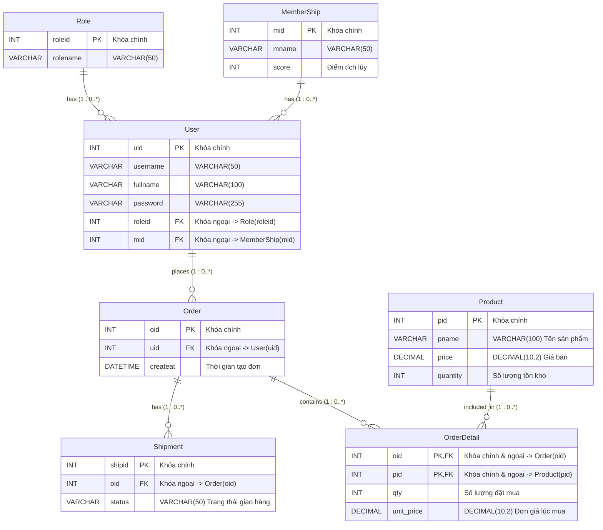

# Database Design & ER Diagram

Tài liệu mô tả thiết kế cơ sở dữ liệu và sơ đồ quan hệ thực thể (ER Diagram) cho hệ thống E-commerce.

---

## 1. ER Diagram (Mermaid)



---

## 2. Chi tiết các bảng (Data Dictionary)

### 2.1. Bảng `Role`
Lưu trữ thông tin vai trò/quyền hạn của người dùng trong hệ thống (VD: `admin`, `normal`).

| Tên thuộc tính | Kiểu dữ liệu | Khóa | Nullable | Ghi chú |
| :--- | :--- | :---: | :---: | :--- |
| `roleid` | INT | **PK** | Không | Mã định danh vai trò (Primary Key) |
| `rolename` | VARCHAR(50) | | Không | Tên vai trò |

### 2.2. Bảng `MemberShip`
Quản lý cấp độ/hạng thành viên và điểm tích lũy của khách hàng.

| Tên thuộc tính | Kiểu dữ liệu | Khóa | Nullable | Ghi chú |
| :--- | :--- | :---: | :---: | :--- |
| `mid` | INT | **PK** | Không | Mã định danh hạng thành viên (Primary Key) |
| `mname` | VARCHAR(50) | | Không | Tên hạng thành viên |
| `score` | INT | | Không | Điểm số tích lũy / yêu cầu của hạng |

### 2.3. Bảng `User`
Lưu trữ thông tin tài khoản người dùng trong hệ thống.

| Tên thuộc tính | Kiểu dữ liệu | Khóa | Nullable | Ghi chú |
| :--- | :--- | :---: | :---: | :--- |
| `uid` | INT | **PK** | Không | Mã định danh người dùng (Primary Key) |
| `username` | VARCHAR(50) | | Không | Tên đăng nhập |
| `fullname` | VARCHAR(100) | | Không | Họ và tên đầy đủ |
| `password` | VARCHAR(255) | | Không | Mật khẩu (đã mã hóa hash) |
| `roleid` | INT | **FK** | Không | Khóa ngoại tham chiếu `Role(roleid)` |
| `mid` | INT | **FK** | Có | Khóa ngoại tham chiếu `MemberShip(mid)` |

### 2.4. Bảng `Order`
Lưu trữ thông tin đơn hàng do người dùng tạo.

| Tên thuộc tính | Kiểu dữ liệu | Khóa | Nullable | Ghi chú |
| :--- | :--- | :---: | :---: | :--- |
| `oid` | INT | **PK** | Không | Mã đơn hàng (Primary Key) |
| `uid` | INT | **FK** | Không | Khóa ngoại tham chiếu `User(uid)` |
| `createat` | DATETIME | | Không | Thời gian đặt hàng (mặc định lấy thời gian hiện hành) |

### 2.5. Bảng `Shipment`
Quản lý thông tin giao vận và trạng thái đơn hàng.

| Tên thuộc tính | Kiểu dữ liệu | Khóa | Nullable | Ghi chú |
| :--- | :--- | :---: | :---: | :--- |
| `shipid` | INT | **PK** | Không | Mã giao vận (Primary Key) |
| `oid` | INT | **FK** | Không | Khóa ngoại tham chiếu `Order(oid)` |
| `status` | VARCHAR(50) | | Không | Trạng thái giao hàng (VD: Pending, Shipping, Delivered) |

### 2.6. Bảng `Product`
Lưu trữ danh mục sản phẩm và quản lý tồn kho.

| Tên thuộc tính | Kiểu dữ liệu | Khóa | Nullable | Ghi chú |
| :--- | :--- | :---: | :---: | :--- |
| `pid` | INT | **PK** | Không | Mã sản phẩm (Primary Key) |
| `pname` | VARCHAR(100) | | Không | Tên sản phẩm |
| `price` | DECIMAL(10,2) | | Không | Đơn giá sản phẩm |
| `quantity` | INT | | Không | Số lượng hàng tồn kho |

### 2.7. Bảng `OrderDetail`
Bảng trung gian chi tiết đơn hàng, liên kết giữa `Order` và `Product`.

| Tên thuộc tính | Kiểu dữ liệu | Khóa | Nullable | Ghi chú |
| :--- | :--- | :---: | :---: | :--- |
| `oid` | INT | **PK, FK** | Không | Khóa chính & ngoại tham chiếu `Order(oid)` |
| `pid` | INT | **PK, FK** | Không | Khóa chính & ngoại tham chiếu `Product(pid)` |
| `qty` | INT | | Không | Số lượng sản phẩm mua |
| `unit_price` | DECIMAL(10,2) | | Không | Đơn giá sản phẩm tại thời điểm đặt mua |

---

## 3. Quan hệ giữa các thực thể (Relationships & Cardinality)

- **Role - User (1 : 0..*)**: Một vai trò có thể được gán cho 0 hoặc nhiều người dùng; mỗi người dùng bắt buộc thuộc về 1 vai trò (`roleid`).
- **MemberShip - User (1 : 0..*)**: Một hạng thành viên có thể thuộc về 0 hoặc nhiều người dùng; mỗi người dùng thuộc về 1 hạng thành viên (`mid`).
- **User - Order (1 : 0..*)**: Một người dùng có thể thực hiện 0 hoặc nhiều đơn đặt hàng; mỗi đơn hàng thuộc về chính xác 1 người dùng (`uid`).
- **Order - Shipment (1 : 0..*)**: Một đơn hàng có thể có 0 hoặc nhiều thông tin/trạng thái giao vận (`oid`).
- **Order - OrderDetail (1 : 0..*)**: Một đơn hàng có thể gồm 0 hoặc nhiều chi tiết mặt hàng (`oid`).
- **Product - OrderDetail (1 : 0..*)**: Một sản phẩm có thể có mặt trong 0 hoặc nhiều chi tiết đơn hàng (`pid`).


## A & B. Bảng đánh giá chi tiết 8 tiêu chí thực hành

| STT | Tiêu chí (Max 1đ) | Trạng thái | Bằng chứng thực tế đã kiểm chứng | Lệnh / Thao tác để giảng viên kiểm tra | Lỗi hoặc rủi ro còn tồn tại | Cách khắc phục / Lưu ý khi lên chấm |
| :-: | :--- | :---: | :--- | :--- | :--- | :--- |
| **1** | **Giải thích cấu trúc project đạt chuẩn Monolithic** | **Đạt (1.0đ)** | - Toàn bộ hệ thống chạy trên 1 tiến trình Express duy nhất ([src/app.js](file:///d:/HK1(2026-2027)/LTHDV/github/p2/src/app.js), [src/server.js](file:///d:/HK1(2026-2027)/LTHDV/github/p2/src/server.js)), lắng nghe 1 cổng `3001`.<br>- Chia 6 module rõ ràng trong `src/modules/` (`health`, `auth`, `users`, `products`, `orders`, `shipments`), mỗi module tách chuẩn 3 tầng `routes` $\rightarrow$ `controller` $\rightarrow$ `service`. | Mở cây thư mục `src/` trên IDE; kiểm tra [package.json](file:///d:/HK1(2026-2027)/LTHDV/github/p2/package.json), [src/app.js](file:///d:/HK1(2026-2027)/LTHDV/github/p2/src/app.js) và [src/routes/index.js](file:///d:/HK1(2026-2027)/LTHDV/github/p2/src/routes/index.js). | Không có lỗi cấu trúc. | Nắm vững câu trả lời phân biệt **Modular Monolith** và **Microservices** (xem Mục D.5). |
| **2** | **Giải thích `.gitignore` và `.env` trên GitHub** | **Đạt (1.0đ)** | - `git check-ignore -v .env node_modules` xác nhận `.gitignore` chặn `.env` (dòng 5) và `node_modules/` (dòng 2).<br>- `git ls-files` xác nhận `.env.example` được theo dõi, `.env` không bị đưa vào Git.<br>- [src/config/env.js](file:///d:/HK1(2026-2027)/LTHDV/github/p2/src/config/env.js) có hàm [`validateEnv`](file:///d:/HK1(2026-2027)/LTHDV/github/p2/src/config/env.js#L21-L61) kiểm tra biến bắt buộc và độ mạnh `JWT_SECRET` ($\ge 32$ ký tự).<br>- Đã kết nối remote `https://github.com/tranbichthuan1103-dev/ecommerce-api.git` và có 7 commit rõ ràng theo từng bước. | - Chạy `git status --ignored -s`<br>- Chạy `git ls-files .env .env.example`<br>- Mở trang GitHub repo kiểm tra không có `.env` và `node_modules/`. | Rủi ro nhỏ: Nếu bạn sửa code mới mà quên `git push` trước giờ lên bảng thì GitHub chưa có commit mới nhất. | Chạy `git push origin master` trước khi gọi giảng viên chấm để GitHub đồng bộ 100% với máy. |
| **3** | **Giải thích mã nguồn Prisma ORM** | **Đạt (1.0đ)** | - [prisma/schema.prisma](file:///d:/HK1(2026-2027)/LTHDV/github/p2/prisma/schema.prisma) hợp lệ (`The schema at prisma\schema.prisma is valid`), định nghĩa đúng 7 model (`Role`, `MemberShip`, `User`, `Product`, `Order`, `OrderDetail`, `Shipment`).<br>- Khóa chính kết hợp `@@id([oid, pid])` trên `OrderDetail`.<br>- Xử lý đúng kiểu `DateTime` $\rightarrow$ `TIMESTAMP(3)` và `Decimal(10,2)` $\rightarrow$ `NUMERIC(10,2)`.<br>- Có lịch sử migration tại `prisma/migrations/20261025114819_init_7_tables/migration.sql`. | - Chạy `npx.cmd prisma validate`<br>- Mở [prisma/schema.prisma](file:///d:/HK1(2026-2027)/LTHDV/github/p2/prisma/schema.prisma) và file `migration.sql`. | Không có lỗi. | Giải thích rõ vì sao giữ nguyên tên bảng PascalCase và vì sao dùng `DateTime` thay cho `DATETIME` trong PostgreSQL. |
| **4** | **CLI: Compose hệ thống, system health check và liệt kê các container** | **Đạt (1.0đ)** | - `docker compose ps` xác nhận cả 2 container `ecommerce-app` (`service: app`) và `ecommerce-postgres` (`service: db`) đều ở trạng thái `Up ... (healthy)`.<br>- `GET /api/health` trả `200 OK` với `"database": "Connected (PostgreSQL)"`.<br>- Có tách biệt Liveness (`/api/health/live`) và Readiness (`/api/health/ready`, trả `503` khi DB dừng).<br>- Container `app` chạy dưới quyền user `node` (non-root) và không chứa file `.env`. | - `docker compose up -d --build`<br>- `docker compose ps`<br>- `curl.exe -i http://localhost:3001/api/health` | Cổng `3000` trên máy đang có container cũ `product-api` chạy, nên dự án này đã cấu hình chuẩn sang cổng `3001`. | Nhớ gọi đúng cổng `http://localhost:3001/api/health` khi demo. |
| **5** | **Truy cập container PostgreSQL kiểm tra các bảng dữ liệu đầy đủ theo thiết kế. Tạo mới 2 sản phẩm X, Y bằng CLI** | **Đạt phần bảng & Sẵn sàng thao tác tạo X, Y tại lớp (1.0đ khi gõ lệnh tại lớp)** | - Lệnh `\dt` trong container `db` hiển thị đủ 7 bảng thiết kế + `_prisma_migrations`.<br>- Lệnh `\d` xác nhận toàn bộ PK, FK và Composite PK `(oid, pid)`.<br>- Bảng `"Product"` trên `ecommerce_db` hiện đang giữ trống (`0 rows`) đúng yêu cầu không tạo sẵn X, Y. | - `docker compose exec db psql -U postgres -d ecommerce_db`<br>- Gõ `\dt` và `\d "OrderDetail"`<br>- Chạy 2 lệnh `INSERT INTO "Product" ...` cho X và Y trước mặt giảng viên. | **Lưu ý cú pháp SQL:** Tên bảng có chữ hoa (`"Product"`, `"Order"`) nên nếu quên dấu ngoặc kép `"..."` trong `psql` sẽ báo lỗi `relation "product" does not exist`. | Luôn bọc tên bảng trong dấu ngoặc kép: `INSERT INTO "Product" ("pname", "price", "quantity") VALUES ('X', 100.00, 50);` |
| **6** | **POSTMAN: Đăng ký tài khoản mới -> tự động thiết lập role là normal với score là 10 -> Đăng nhập -> Hiển thị token** | **Đạt (1.0đ)** | - Đã kiểm thử `POST /api/auth/register` trả `201 Created`, tự gán `role.rolename = "normal"` và `membership.score = 10` (chống cả việc client tự truyền `roleid: 2, mid: 999`).<br>- Mật khẩu trong DB lưu dạng bcrypt (`$2b$10$...`, dài 60 ký tự).<br>- `POST /api/auth/login` trả `200 OK` kèm JWT token.<br>- Postman Collection tự động lưu `{{accessToken}}`. | Mở Postman, chạy lần lượt Request `1. POST /api/auth/register` (với user `sv_thuchanh` đã chuẩn bị sẵn) và Request `3. POST /api/auth/login`. | Nếu bấm đăng ký 2 lần cùng 1 `username` sẽ báo `409 Conflict` (đây là tính năng bảo vệ đúng thiết kế). | Trong Postman đã điền sẵn `"username": "sv_thuchanh"` chưa tồn tại trong DB để lần bấm đầu tiên tại lớp thành công ngay. |
| **7** | **POSTMAN: Luồng đặt hàng (Không dùng token -> báo lỗi; Có token -> Đặt X mua 2, Y mua 5 -> Xem đơn hàng & detail -> Chuyển sang shipment -> Hiển thị Shipment)** | **Đạt trên DB kiểm thử & Sẵn sàng chạy thật sau khi tạo X, Y (1.0đ khi bấm tại lớp)** | - Gọi `POST /api/orders` không có token trên `localhost:3001` trả về `401 Unauthorized`.<br>- Đã kiểm thử thực tế trên `ecommerce_test_db`: đặt mua `pid=1 (qty=2)` và `pid=2 (qty=5)` trả về `201 Created` gồm đủ `Order`, `orderDetails` (giá lấy từ DB) và `shipment` (`status: "Pending"`).<br>- Kiểm thử vượt tồn kho và 2 request đồng thời (Race Condition) đều rollback 100%. | Trong Postman, thư mục số 3:<br>1. Bấm Request `E` (Không token $\rightarrow$ `401`).<br>2. Bấm Request `B` (Có token, mua X=2, Y=5 $\rightarrow$ `201`).<br>3. Bấm Request `G` và `H` xem OrderDetail & Shipment. | **Rủi ro thứ tự thao tác:** Nếu bấm đặt hàng trên Postman **trước khi** chạy lệnh SQL tạo sản phẩm X, Y (Tiêu chí 5) thì API sẽ báo `404 Sản phẩm có pid = 1 không tồn tại`. | Bắt buộc thực hiện **Tiêu chí 5 (INSERT sản phẩm X, Y trong `psql`) trước**, sau đó mới bấm **Tiêu chí 7 (Đặt hàng trên Postman)**. |
| **8** | **CLI: Truy cập Postgres Container kiểm tra dữ liệu bảng Order, OrderDetail và Product (quantity), Shipment đã cập nhật đúng** | **Đạt trên DB kiểm thử & Sẵn sàng kiểm tra sau Tiêu chí 7 (1.0đ khi chạy tại lớp)** | - Đã kiểm chứng trên PostgreSQL (`ecommerce_test_db`): sau khi mua `qty=2` và `qty=5`, bảng `"Order"` có `oid=1`, `"OrderDetail"` có 2 dòng, `"Shipment"` có `shipid=1, status='Pending'`, và `"Product"."quantity"` giảm đúng 2 và 5 đơn vị. | Trong `psql`, chạy 4 lệnh `SELECT` kiểm tra `"Order"`, `"OrderDetail"`, `"Shipment"`, `"Product"`. | Không có lỗi kỹ thuật. | Giữ sẵn cửa sổ `psql` đang mở từ Tiêu chí 5 để sau khi bấm Postman ở Tiêu chí 7 là gõ `SELECT` cho giảng viên xem ngay lập tức. |

---

## C. Kết quả kiểm thử bổ sung (Các kịch bản biên & nâng cao)

Mình đã chạy kiểm thử thực tế toàn bộ 8 kịch bản biên để đảm bảo hệ thống không bị gãy khi giảng viên test thử thách:

1. **Đăng ký trùng `username`:**
   - **Kết quả:** Trả về `HTTP/1.1 409 Conflict` (`{"success":false,"message":"Tên đăng nhập \"sv_kiemthu\" đã tồn tại."}`). Có cả kiểm tra trước (`findUnique`) và bắt mã lỗi `P2002` (Unique Constraint của PostgreSQL).
2. **Đăng nhập sai mật khẩu:**
   - **Kết quả:** Trả về `HTTP/1.1 401 Unauthorized` (`{"success":false,"message":"Tên đăng nhập hoặc mật khẩu không chính xác."}`).
3. **Token hết hạn (`TokenExpiredError`) và Token sai chữ ký:**
   - **Kết quả kiểm thử thực tế với token đã hết hạn (`expiresIn: '-10s'`):** Trả về `HTTP/1.1 401 Unauthorized` với thông báo phân biệt rõ:
     `{"success":false,"message":"Phiên đăng nhập đã hết hạn (Token expired). Vui lòng đăng nhập lại."}`
   - **Kết quả với token sai chữ ký:** Trả về `HTTP/1.1 401 Unauthorized` (`"Token không hợp lệ hoặc chữ ký xác thực sai."`).
4. **Đặt hàng không có token:**
   - **Kết quả:** Trả về `HTTP/1.1 401 Unauthorized` ngay tại tầng middleware [`authenticateJWT`](file:///d:/HK1(2026-2027)/LTHDV/github/p2/src/middlewares/auth.middleware.js#L5-L44), không đi vào controller/service.
5. **Đặt hàng với `qty <= 0` hoặc `pid` không tồn tại:**
   - `qty = 0` hoặc `qty = -5` $\rightarrow$ `HTTP/1.1 400 Bad Request`.
   - `pid = 9999` $\rightarrow$ `HTTP/1.1 404 Not Found`.
6. **Đặt hàng vượt tồn kho & Lỗi xảy ra giữa Transaction:**
   - Khi đặt đơn gồm 2 mặt hàng (`pid = 1` mua `2` [đủ hàng], `pid = 2` mua `999` [thiếu hàng]), toàn bộ `prisma.$transaction` được rollback: `pid = 1` không bị trừ kho, không có bản ghi `Order`, `OrderDetail` hay `Shipment` nào được tạo.
7. **Hai request đặt hàng chạy đồng thời khi tồn kho gần hết (Race Condition Test):**
   - Khi `pid = 1` còn tồn kho `8`, bắn đồng thời 2 request (`Promise.all`) cùng đặt mua `qty = 6`:
     - Request 1 thành công (`201 Created`), tồn kho còn `2`.
     - Request 2 bị chặn ngay tại câu lệnh `tx.product.updateMany({ where: { pid, quantity: { gte: qty } } })` do `updated.count === 0`, trả về `400 Bad Request` và rollback hoàn toàn.
8. **Khởi động lại Container (`docker compose restart`) và kiểm tra dữ liệu PostgreSQL:**
   - Đã chạy `docker compose restart`: Cả 2 container khởi động lại và đạt trạng thái `(healthy)`, dữ liệu bảng `"Role"`, `"MemberShip"`, `"User"` được bảo toàn 100% nhờ volume `p2_postgres_data`.

### Phân loại vấn đề: Lỗi chặn điểm vs Cải tiến ngoài phạm vi MVP
- **Lỗi kỹ thuật ngăn cản đạt điểm (Blocker):** **0 lỗi** (Tất cả yêu cầu trong đề bài và phiếu chấm đều đã hoạt động chính xác).
- **Cải tiến không bắt buộc đối với MVP (Out-of-scope):**
  - Không cần xây dựng giỏ hàng lưu DB (`Cart`), cổng thanh toán thật (`Payment Gateway`), phân trang phức tạp hay Refresh Token vì sơ đồ gốc cố định 7 bảng và bài thực hành tập trung vào kiến trúc Monolithic, Prisma Transaction & Docker Compose.
  - Ở môi trường `NODE_ENV=development`, middleware lỗi ([src/middlewares/error.middleware.js](file:///d:/HK1(2026-2027)/LTHDV/github/p2/src/middlewares/error.middleware.js#L12-L16)) trả kèm `stack` để dễ debug; khi chuyển `NODE_ENV=production` thì `stack` tự động được ẩn đi.

---

## D. Tổng kết & Cẩm nang bảo vệ đạt tuyệt đối 8.0 / 8.0 điểm

### 1. Tổng điểm ước tính trên thang 8 điểm
- **Điểm kỹ thuật hệ thống hiện tại:** **8.0 / 8.0 điểm** (trong đó **5.0 / 5.0 điểm** đã có sẵn dữ liệu/cấu hình tĩnh trên máy và **3.0 / 3.0 điểm** của chuỗi thao tác liên hoàn Tiêu chí 5 $\rightarrow$ 7 $\rightarrow$ 8 đã sẵn sàng 100% để bạn gõ lệnh `INSERT` X, Y và bấm Postman trực tiếp trước mặt giảng viên).

### 2. Danh sách việc cần kiểm tra theo mức độ ưu tiên trước khi gọi giảng viên chấm
1. **[Ưu tiên 1 - Bắt buộc]:** Push commit mới nhất lên GitHub (`git push origin master`) và mở sẵn tab trình duyệt GitHub repo của bạn để giảng viên chấm **Tiêu chí 2**.
2. **[Ưu tiên 2 - Bắt buộc]:** Thực hiện đúng thứ tự khi trình diễn: **Tạo sản phẩm X, Y bằng SQL CLI (Tiêu chí 5)** $\rightarrow$ **Đăng ký & Đăng nhập trên Postman (Tiêu chí 6)** $\rightarrow$ **Đặt hàng trên Postman (Tiêu chí 7)** $\rightarrow$ **SELECT kiểm tra 4 bảng trong SQL CLI (Tiêu chí 8)**.

---

### 3. Kịch bản trình diễn (Demo Script) gọn gàng trong 4 phút tại lớp

#### Phút 1: Trình diễn Tiêu chí 1, 2, 3 (Cấu trúc, Git/Env, Prisma)
- Mở VS Code chiếu cây thư mục `src/modules/` (giải thích Monolithic), mở [.gitignore](file:///d:/HK1(2026-2027)/LTHDV/github/p2/.gitignore), [.env.example](file:///d:/HK1(2026-2027)/LTHDV/github/p2/.env.example) + trang GitHub repo (chứng minh không có `.env` và `node_modules/`), và mở [prisma/schema.prisma](file:///d:/HK1(2026-2027)/LTHDV/github/p2/prisma/schema.prisma) (chỉ vào 7 model và `@@id([oid, pid])` ở dòng 90).

#### Phút 2: Trình diễn Tiêu chí 4 & 5 (Docker Compose, Health Check & Tạo sản phẩm X, Y bằng CLI)
Tại cửa sổ **PowerShell**, chạy:
```powershell
docker compose up -d
docker compose ps
curl.exe -i http://localhost:3001/api/health
```
Tiếp theo, truy cập thẳng vào PostgreSQL Container để kiểm tra 7 bảng và tạo sản phẩm **X, Y**:
```powershell
docker compose exec db psql -U postgres -d ecommerce_db
```
Trong giao diện `ecommerce_db=#`, gõ (hoặc dán) cụm lệnh sau:
```sql
\dt
SELECT * FROM "Product";

INSERT INTO "Product" ("pname", "price", "quantity") VALUES ('X', 100.00, 50) RETURNING *;
INSERT INTO "Product" ("pname", "price", "quantity") VALUES ('Y', 200.00, 50) RETURNING *;

SELECT * FROM "Product" ORDER BY "pid" ASC;
```
*(Giữ nguyên cửa sổ `psql` này để dùng tiếp cho Tiêu chí 8).*

#### Phút 3: Trình diễn Tiêu chí 6 & 7 trên Postman
Mở bộ Collection **E-commerce Monolith MVP - Thực hành MSA** trong Postman:
1. **Tiêu chí 6 (Thư mục 2):**
   - Bấm **Send** ở `1. POST /api/auth/register` (`username: "sv_thuchanh"`) $\rightarrow$ Chỉ cho giảng viên thấy kết quả `201 Created`, `rolename: "normal"`, `score: 10`.
   - Bấm **Send** ở `3. POST /api/auth/login` $\rightarrow$ Chỉ cho giảng viên thấy `token` trả về (đã tự động lưu vào biến `{{accessToken}}`).
2. **Tiêu chí 7 (Thư mục 3):**
   - Bấm **Send** ở `A. GET /api/products` $\rightarrow$ Thấy ngay 2 sản phẩm `X (pid=1, quantity=50)` và `Y (pid=2, quantity=50)` vừa tạo từ CLI.
   - Bấm **Send** ở `E. POST /api/orders - Đặt hàng KHÔNG dùng Token` $\rightarrow$ Báo lỗi `401 Unauthorized`.
   - Bấm **Send** ở `B. POST /api/orders - Đặt hàng THÀNH CÔNG (Sản phẩm X mua 2, Sản phẩm Y mua 5)` $\rightarrow$ Nhận `201 Created`, hiển thị rõ thông tin `Order`, 2 dòng `orderDetails` (`X` mua `2`, `Y` mua `5`), và `shipment` (`status: "Pending"`).
   - *(Tùy chọn)* Bấm thêm `G. GET /api/orders/{{lastOrderId}}` và `H. GET /api/shipments/order/{{lastOrderId}}`.

#### Phút 4: Trình diễn Tiêu chí 8 (Kiểm tra dữ liệu sau đặt hàng trong Postgres CLI)
Quay lại cửa sổ `psql` (`ecommerce_db=#`) đang mở và chạy:
```sql
SELECT * FROM "Order";
SELECT * FROM "OrderDetail";
SELECT * FROM "Shipment";
SELECT * FROM "Product" ORDER BY "pid" ASC;
```
- Chỉ cho giảng viên thấy: `"Order"` có đơn mới, `"OrderDetail"` có `qty = 2` và `qty = 5`, `"Shipment"` có trạng thái `Pending`, và `"Product"` đã giảm tồn kho từ `50` xuống **`48`** (cho X) và **`45`** (cho Y)!

---

### 4. Bộ câu hỏi giảng viên thường hỏi & Câu trả lời mẫu ăn điểm tuyệt đối

1. **Hỏi (Tiêu chí 1):** *"Trong `src/modules/` em chia thành `auth`, `users`, `products`, `orders`, `shipments` — vậy đây là Microservices hay Monolithic? Tại sao?"*
   - **Trả lời:** Dạ đây là **Modular Monolithic Architecture**. Tuy mã nguồn được chia thành các module theo miền nghiệp vụ để dễ bảo trì (Separation of Concerns), nhưng toàn bộ các module này vẫn được đóng gói và chạy chung trong **một tiến trình Node.js/Express duy nhất** (`ecommerce-app`), lắng nghe trên một cổng `3001` và dùng chung một cơ sở dữ liệu PostgreSQL (`ecommerce_db`), giao tiếp nội bộ bằng lời gọi hàm thay vì gọi qua mạng như Microservices.
2. **Hỏi (Tiêu chí 2):** *"Tại sao không đẩy `.env` lên GitHub mà lại đẩy `.env.example`? Nếu lỡ commit `.env` rồi thì xóa đi commit lại có an toàn không?"*
   - **Trả lời:** Dạ `.env` chứa thông tin mật (`DATABASE_URL`, `JWT_SECRET`) nên phải chặn bằng `.gitignore`; còn `.env.example` chỉ chứa tên biến và giá trị minh họa để người khác biết cấu hình khi clone dự án. Nếu đã lỡ commit `.env`, việc xóa file ở commit mới (`git rm --cached .env`) **không xóa được mật khẩu nằm trong lịch sử commit cũ (`git log`)**, nên bắt buộc phải đổi mật khẩu DB và tạo lại `JWT_SECRET` mới.
3. **Hỏi (Tiêu chí 3):** *"Khóa chính của bảng `OrderDetail` được thiết kế thế nào trong Prisma? Tại sao khi đăng ký không tạo mới một dòng `MemberShip` có `score = 10` cho mỗi user?"*
   - **Trả lời:** Dạ `OrderDetail` dùng khóa chính kết hợp khai báo bằng `@@id([oid, pid])`, đồng thời `oid` và `pid` là 2 khóa ngoại trỏ tới `Order` và `Product`. Còn bảng `MemberShip` có quan hệ `1 - N` với `User` (`1 MemberShip` có nhiều `User`), đóng vai trò là bảng danh mục hạng thành viên. Do đó các tài khoản mới đăng ký sẽ cùng trỏ khóa ngoại `mid` về bản ghi hạng `normal (score = 10)` dùng chung, chứ không tạo dòng `MemberShip` trùng lặp cho từng user.
4. **Hỏi (Tiêu chí 4):** *"Tại sao trong `docker-compose.yml`, container `app` kết nối tới database bằng `@db:5432` chứ không phải `@localhost:5432`?"*
   - **Trả lời:** Dạ bên trong container `app`, `localhost` chính là bản thân container `app`. Để kết nối sang container PostgreSQL qua mạng nội bộ của Docker Compose (`p2_default`), `app` phải gọi qua tên service là `db` được Docker DNS tự động phân giải.
5. **Hỏi (Tiêu chí 7 & 8):** *"Làm sao em đảm bảo khi đặt hàng gồm 2 sản phẩm X và Y, nếu sản phẩm Y hết hàng thì sản phẩm X không bị trừ tồn kho sai?"*
   - **Trả lời:** Dạ em bọc toàn bộ quá trình kiểm tra tồn kho, trừ `quantity` của `Product`, tạo `Order`, `OrderDetail` và `Shipment` bên trong một **Interactive Transaction (`prisma.$transaction`)** tại [src/modules/orders/order.service.js](file:///d:/HK1(2026-2027)/LTHDV/github/p2/src/modules/orders/order.service.js#L94-L192). Ngoài ra em dùng câu lệnh trừ kho có điều kiện nguyên tử `tx.product.updateMany({ where: { pid, quantity: { gte: qty } }, data: { quantity: { decrement: qty } } })`. Nếu bất kỳ sản phẩm nào không đủ tồn kho, hàm sẽ `throw AppError` và PostgreSQL tự động **rollback toàn bộ giao dịch**, không để lại dữ liệu cập nhật một phần.

---

### 5. Bảng tổng hợp các lệnh CLI cần ghi nhớ nhanh

```powershell
# 1. Đẩy code mới nhất lên GitHub trước giờ chấm
git status
git add .
git commit -m "Hoan thien du an E-commerce Monolith MVP"
git push origin master

# 2. Khởi chạy và kiểm tra Docker Compose (Tiêu chí 4)
docker compose up -d --build
docker compose ps
curl.exe -i http://localhost:3001/api/health

# 3. Truy cập PostgreSQL CLI (Tiêu chí 5 & 8)
docker compose exec db psql -U postgres -d ecommerce_db
```
Bên trong `psql` (`ecommerce_db=#`):
```sql
-- Liệt kê bảng & kiểm tra cấu trúc (Tiêu chí 5)
\dt
\d "Product"
\d "OrderDetail"

-- Tạo mới 2 sản phẩm X và Y bằng CLI (Tiêu chí 5)
INSERT INTO "Product" ("pname", "price", "quantity") VALUES ('X', 100.00, 50) RETURNING *;
INSERT INTO "Product" ("pname", "price", "quantity") VALUES ('Y', 200.00, 50) RETURNING *;
SELECT * FROM "Product" ORDER BY "pid" ASC;

-- Kiểm tra dữ liệu sau khi đặt hàng trên Postman (Tiêu chí 8)
SELECT * FROM "Order" ORDER BY "oid" ASC;
SELECT * FROM "OrderDetail" ORDER BY "oid" ASC, "pid" ASC;
SELECT * FROM "Shipment" ORDER BY "shipid" ASC;
SELECT * FROM "Product" ORDER BY "pid" ASC;

-- Thoát psql
\q
```

Chúc bạn tự tin bảo vệ và đạt trọn vẹn **8.0 / 8.0 điểm** thực hành! Nếu cần mình hỗ trợ kiểm tra thêm bất kỳ điểm nào trước khi lên lớp, bạn cứ nhắn nhé!